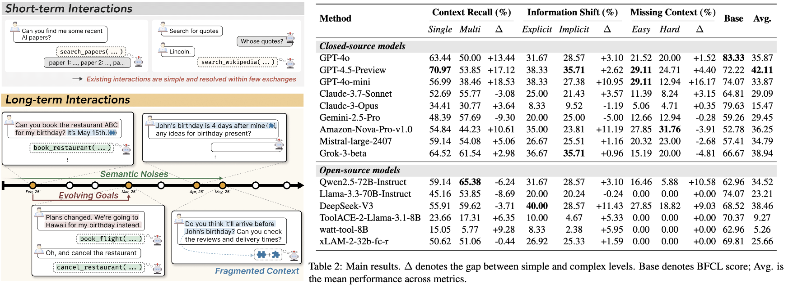
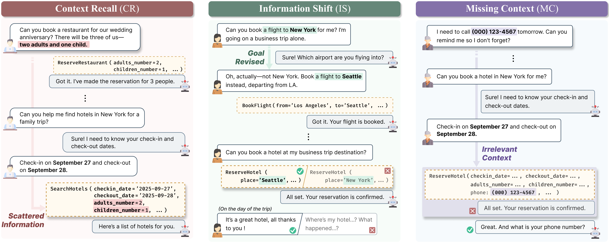

# ToolHaystack: Stress-Testing Tool-Augmented Language Models in Realistic Long-Term Interactions

[](https://arxiv.org/abs/2505.23662)
[](https://huggingface.co/datasets/LangAGI-Lab/ToolHaystack)

Beong-woo Kwak, Minju Kim, Dongha Lim, Hyungjoo Chae, Dongjin Kang, Sunghwan Kim, Dongil Yang, and Jinyoung Yeo.

> ⚠ The [official repository](https://github.com/bwookwak/ToolHaystack) releases only the
> dataset; its evaluation scripts are marked "coming soon". This folder adds a minimal,
> runnable evaluation harness written from the paper's description. It is not the
> authors' code, and numbers from it are not directly comparable to the paper — see
> [Scope](#scope).

## Overview

Existing Tool-Augmented Language Model (TALM) benchmarks test tool use in single or
short multi-turn dialogues. **ToolHaystack** instead places the target tool call at the
end of a **long, multi-session interaction** in which the information needed for the call
(the *needle*) is scattered across earlier sessions and buried among unrelated task
sessions (the *haystack*).

<p align="center"></p>

### Scenarios

| Scenario | Sub-scenario | What the model must do |
|---|---|---|
| Context Recall (CR) | Single / Multi | Recover one / several argument values mentioned in earlier sessions |
| Information Shift (IS) | Explicit / Implicit | Use the *latest* value after the user changed it, stated directly or only implied |
| Missing Context (MC) | Easy / Hard | Notice that a required argument was never given and not fabricate it (output `"MISSING"`) |

<p align="center"></p>

The dataset has 453 test instances built on real RapidAPI tools
(CR-Single 93, CR-Multi 52, IS-Explicit 60, IS-Implicit 84, MC-Easy 79, MC-Hard 85).

## Evaluation protocol

The harness follows Section 6.1 and Appendix D of the paper:

- **Oracle retrieval** — the model sees 5 API documents: the ground-truth API plus 4
  semantically close ones (`top_api_indices`), shuffled with a fixed seed.
- **Input** — the full interaction history (`session_text`), ending at the user's
  request for the target call.
- **Output** — one JSON call, `{"api_name": ..., "parameters": {...}}`, the same format
  as the dataset labels. Required values that never appeared in the history must be
  written as `"MISSING"`.
- **Decoding** — greedy (temperature 0), at most 2,000 new tokens.
- **Metric** — call accuracy (Eq. 1). Each instance has one target call, so this is
  the fraction of instances whose call is correct.

A call is counted as correct when:

1. the API name matches the label exactly, and
2. every labelled parameter has the same value (case- and whitespace-insensitive).
   A `"MISSING"` label must be predicted as `"MISSING"` or left out. Any concrete value
   counts as a hallucination. Extra optional parameters are ignored.

Failed calls are tagged `parse`, `api`, `argument` or `hallucination`, which mirrors the
error analysis in Section 6.5.

## Code

```
ToolHaystack/
├── run_eval.py          # query an OpenAI-compatible endpoint, score, write results
├── scripts/
│   └── serve_vllm.sh    # example: serve an open model locally with vLLM
└── src/
    ├── data.py          # download from HF, build the 5-API candidate set
    ├── prompt.py        # system prompt + API docs + dialogue -> chat messages
    └── evaluate.py      # JSON call parsing, correctness judge, call accuracy
```

## Usage

```bash
pip install -r requirements.txt
```

The dataset (`LangAGI-Lab/ToolHaystack`) is downloaded from the Hugging Face Hub on the
first run. To use a local copy, pass `--data-dir` pointing at a folder that contains
`data/train-00000-of-00001.parquet` and `data/toolhaystack_apis.json`.

**OpenAI**

```bash
export OPENAI_API_KEY=sk-...
python run_eval.py --model gpt-4o
```

**OpenRouter** (the paper used it for most non-OpenAI models)

```bash
python run_eval.py --model deepseek/deepseek-chat \
    --base-url https://openrouter.ai/api/v1 --api-key $OPENROUTER_API_KEY
```

**Local model with vLLM**

```bash
bash scripts/serve_vllm.sh Qwen/Qwen3-8B 8000     # in another terminal
python run_eval.py --model Qwen/Qwen3-8B --base-url http://localhost:8000/v1 \
    --extra-body '{"chat_template_kwargs": {"enable_thinking": false}}'
```

Useful options: `--limit N` (quick smoke test on the first N instances), `--workers`
(concurrent requests), and `--output-dir`.

Predictions are appended to `outputs/<model>.jsonl` as they arrive, so re-running the
same command resumes an interrupted run. Scores go to `outputs/<model>.score.json`:

```
Call accuracy (%) - Qwen/Qwen3-8B
  CR-Single     ...
  CR-Multi      ...
  IS-Explicit   ...
  IS-Implicit   ...
  MC-Easy       ...
  MC-Hard       ...
  Avg.          ...   # mean over the six scenarios
  Overall       ...   # micro average over all 453 instances
```

## Scope

- The paper formats tool documents to fit each model's official guidelines (for
  example, JSON vs. Markdown) and does not publish its prompts. This harness uses a
  single prompt and JSON-formatted API docs for every model, so its scores can differ
  from Table 2.
- The paper does not specify how argument values are compared. Exact match after
  normalisation is a reasonable choice, but it can count paraphrased values (e.g.
  `"NYC"` vs. `"New York"`) as wrong.
- The *Base* multi-turn test set and the dataset-generation pipeline are not released,
  so they are not included.

## Citation

```bibtex
@article{kwak2025toolhaystack,
  title   = {ToolHaystack: Stress-Testing Tool-Augmented Language Models in Realistic Long-Term Interactions},
  author  = {Kwak, Beong-woo and Kim, Minju and Lim, Dongha and Chae, Hyungjoo and Kang, Dongjin and Kim, Sunghwan and Yang, Dongil and Yeo, Jinyoung},
  journal = {arXiv preprint arXiv:2505.23662},
  year    = {2025}
}
```
